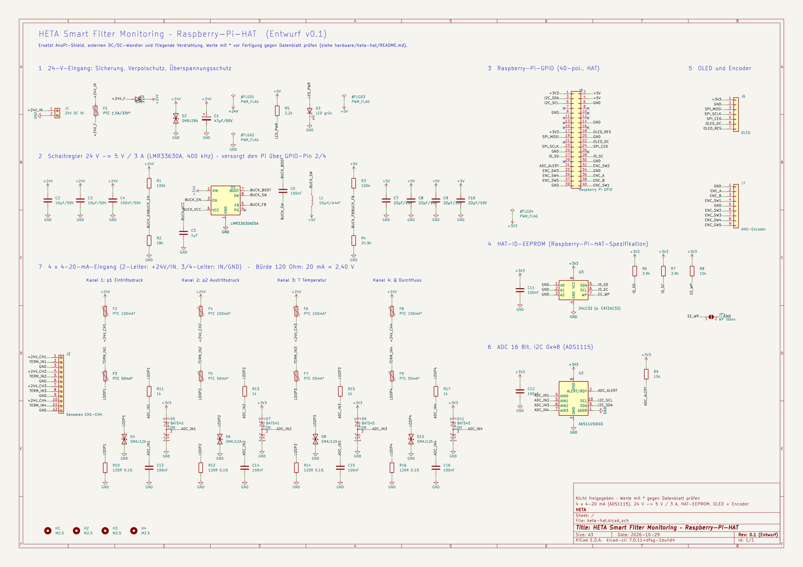
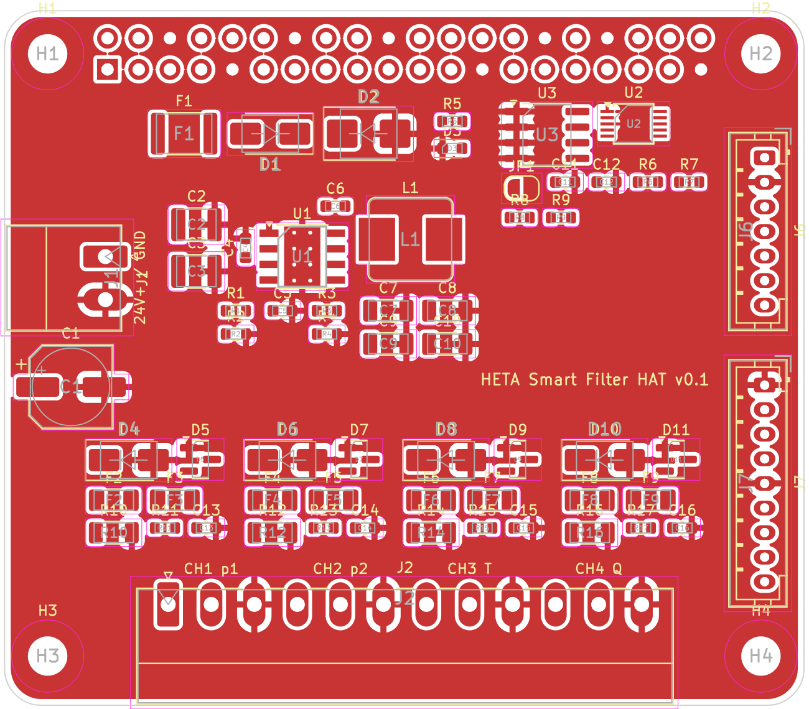

# HETA-HAT – eigene Aufsteckplatine für den Raspberry Pi (Entwurf v0.1)

KiCad-Projekt einer Raspberry-Pi-HAT-Platine (65 × 56,5 mm), die den heutigen Modulaufbau
ersetzt: **AnoPi-Shield, externer 24-V→5-V-Wandler und die fliegende Verdrahtung** von OLED
und Encoder wandern auf eine Platine.

> **Status: Entwurf, nicht fertigungsreif.** Schaltplan und Bauteilplatzierung sind fertig und
> geprüft, **die Leiterbahnen sind noch nicht geroutet** (offene Punkte siehe unten).
> Werte mit `*` vor der Fertigung gegen das Datenblatt prüfen.

| Schaltplan | Platzierung (Oberseite) |
|---|---|
|  |  |

Schaltplan als PDF: [`fertigung/heta-hat-schaltplan.pdf`](fertigung/heta-hat-schaltplan.pdf) ·
Stückliste: [`fertigung/heta-hat-stueckliste.csv`](fertigung/heta-hat-stueckliste.csv)

---

## Funktionsblöcke

| Block | Lösung |
|---|---|
| 24-V-Eingang | PTC-Sicherung 1,5 A (F1), Verpolschutz-Schottky SS34 (D1), TVS SMBJ28A (D2), 47 µF gegen Kabelresonanz |
| 5-V-Versorgung Pi | Schaltregler TI LMR33630A (400 kHz, 3 A), speist den Pi über GPIO-Pin 2/4, EN-Schwelle ≈ 8 V, Betriebs-LED |
| 4 × 4–20 mA | Je Kanal: abgesicherte Sensorversorgung (PTC 100 mA), PTC 50 mA vor der Bürde, TVS SMAJ12A, Bürde 120 Ω 0,1 %, RC-Tiefpass 1 kΩ/100 nF, Klemmdioden BAT54S auf 0…3,3 V |
| ADC | TI ADS1115, 16 Bit, I²C-Adresse **0x48**, ALERT/RDY an GPIO 6 |
| HAT-ID-EEPROM | 24LC32 an ID_SD/ID_SC (Adresse 0x50), Schreibschutz per Lötbrücke JP1 lösbar |
| OLED / Encoder | JST-PH-Stecker (verriegelnd), **gleiche GPIO-Belegung wie heute** – `config/settings.json` bleibt unverändert |

### Auslegung 4–20 mA

- Bürde 120 Ω: 4 mA = 0,48 V · 20 mA = 2,40 V · 25 mA = 3,00 V (Reserve für NAMUR-NE43-Fehlerströme bis 21 mA und darüber)
- ADS1115 im Bereich ±4,096 V: 125 µV/LSB ≙ **1,04 µA** Auflösung (≈ 0,007 % der 16-mA-Spanne)
- Für 2-Leiter-Sensoren bleiben bei 24 V und 20 mA rund 20 V Schleifenspannung
- Fehlanschluss von 24 V direkt auf den Signaleingang: PTC F3/F5/F7/F9 löst aus, TVS und Klemmdioden schützen den ADC

### Steckerbelegung

| Stecker | Pin | Signal |
|---|---|---|
| **J1** 24 V DC (Phoenix MC 1,5/2-G-3,5, linke Kante) | 1 / 2 | +24 V / GND |
| **J2** Sensoren (Phoenix MC 1,5/12-G-3,5, Unterkante, für 4 × 3-pol. Stecker) | 1–3 | CH1 p1: +24 V (abgesichert), Signal, GND |
| | 4–6 | CH2 p2: +24 V, Signal, GND |
| | 7–9 | CH3 T: +24 V, Signal, GND |
| | 10–12 | CH4 Q: +24 V, Signal, GND |
| **J6** OLED (JST PH 7-pol.) | 1–7 | 3V3, GND, DIN (GPIO 10), CLK (GPIO 11), CS (GPIO 8), DC (GPIO 25), RES (GPIO 24) |
| **J7** Encoder (JST PH 9-pol.) | 1–9 | COMA=GND, ENCA (16), ENCB (20), SW1 (21), COMB=GND, SW2 (12), SW3 (13), SW4 (19), SW5 (26) |
| **J8** GPIO (2 × 20 Buchse, Unterseite) | | I²C1 (GPIO 2/3) für den ADC, ID_SD/ID_SC (GPIO 0/1) für das EEPROM |

2-Leiter-Sensoren (ifm PL5423, TA2405) zwischen „+24 V“ und „Signal“, 3/4-Leiter-Sensoren
(Keyence FD-X) mit eigener Versorgung zwischen „Signal“ und „GND“.

---

## Offene Punkte vor der Fertigung

- [ ] **Routing.** Den Leistungsteil (U1, C2–C4, L1, C7–C10) nach dem Layoutbeispiel im
      LMR33630-Datenblatt führen: kurze Schleife VIN–Cin–GND, kleine SW-Fläche, FB-Leitung weg
      von SW. Analogeingänge getrennt vom Schaltregler, GND-Flächen auf beiden Lagen sind angelegt.
      Netzklassen sind vorbereitet (Power 0,8 mm, 24 V Sensorversorgung 0,5 mm, Signal 0,25 mm).
- [ ] **Werte mit `*` prüfen:** PTC-Typen (Haltestrom, Spannungsfestigkeit ≥ 30 V), Spule
      (≥ 4 A Sättigungsstrom), Stromverbrauch des Keyence FD-X gegen PTC 100 mA.
- [ ] **Rückspeiseschutz:** Die 5 V gehen direkt auf den GPIO-Header. Solange keine ideale Diode
      ergänzt ist, **nie gleichzeitig ein USB-C-Netzteil am Pi und 24 V an J1** anschließen.
- [ ] **Raspberry Pi 5:** 3 A reichen für Pi 5 mit Display und Encoder. Ohne USB-PD-Netzteil
      begrenzt der Pi 5 die USB-Ports auf 600 mA; für mehr USB-Last wäre ein 5-A-Regler nötig.
- [ ] **EMV:** Bei langen Sensorleitungen ggf. Gleichtaktdrossel/Ferrite an J1 und J2, Schirm
      auf PE am Gehäuse. Für die CE-Kennzeichnung ist eine EMV-Prüfung nötig.
- [ ] **Software:** `backend/sensors.py` liest heute das AnoPi-Shield (`python-anopi`). Für die
      HAT-Platine wird ein ADS1115-Treiber gebraucht (I²C 0x48, Messwert / 120 Ω = Strom).
- [ ] **HAT-EEPROM** nach der Bestückung mit `eepmake`/`eepflash` (Raspberry-Pi-Tools)
      beschreiben; dazu JP1 schließen.

---

## Arbeiten mit dem Projekt

- Öffnen mit **KiCad 7 oder neuer** (`heta-hat.kicad_pro`). KiCad 8/9 konvertieren die Dateien
  beim ersten Speichern; Symbole und Footprints stammen aus den Standardbibliotheken.
- Exporte (Schaltplan-PDF, Stückliste, Gerber, Bohr- und Bestückdaten):

  ```bash
  ./hardware/heta-hat/scripts/export.sh
  ```

  Gerber- und Bestückdaten werden nicht versioniert (`.gitignore`), weil sie erst nach dem
  Routing gültig sind.

### Was bereits geprüft ist

- **Verdrahtung:** Die aus dem Schaltplan exportierte Netzliste wurde automatisch gegen die
  Sollverdrahtung abgeglichen (46 Netze, alle Pins korrekt, keine Netze mit nur einem Anschluss).
- **DRC:** keine Bauteilüberlappungen, keine Abstands- oder Kantenfehler. Offen sind nur die
  99 noch nicht gerouteten Verbindungen und zwei Thermal-Hinweise an GND-Pads, die sich beim
  Routen erledigen. Silkscreen-Hinweise (überlappende Referenzen) sind kosmetisch.
- **Mechanik:** Kontur, Radien und Montagelöcher (M2,5 bei 3,5 / 61,5 × 3,5 / 52,5 mm) sowie
  die Lage der GPIO-Leiste (Pin 1 bei 8,37 / 4,77 mm) nach Raspberry-Pi-HAT-Spezifikation.

Die Dateien wurden mit KiCad 7.0.11 erzeugt (Schaltplan und Platzierung skriptgesteuert,
danach regulär in KiCad weiterbearbeitbar).
